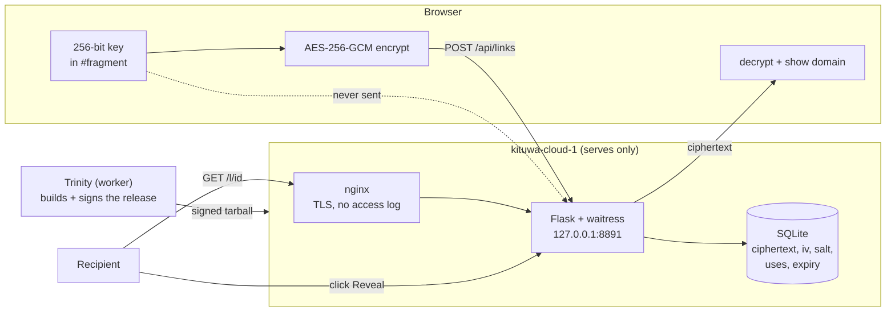

# links.kituwa.com

Short links that are end-to-end encrypted: the server stores a sealed box, a
counter and a clock. It never sees the destination, the note, the password or
the key.

Live: <https://links.kituwa.com> · Source: <https://github.com/CrystalRockMarket/links-kituwa>

## What it does

- Two modes on the create form. **Simple** (the default) asks for a URL, how
  many opens and how long — three answers, one button. **Advanced** adds a note,
  a password, a start time, redirect behaviour and URL bundles. The choice is
  remembered in the browser only.
- Paste one or more URLs, choose uses and expiry, and get a share link.
- The browser generates a 256-bit key, encrypts `{urls, note, createdAt}` with
  AES-256-GCM, and sends only `{ciphertext, iv, options}` to the server.
- The key travels in the URL fragment: `/l/<id>#<key>`. Browsers never send a
  fragment to a server, so the server cannot decrypt anything it stores.
- Opening a link page fetches nothing and spends nothing. Only a click on
  **Reveal** calls `POST /api/links/<id>/consume`, which atomically spends one
  use and returns the ciphertext.
- When the last use is spent or the link expires, the ciphertext is overwritten
  with `NULL` in the database. The row that remains is contentless and is
  deleted after seven days.
- No accounts, no cookies, no IP addresses, no user agents, no referrers, no
  per-click rows. The proxy writes no access log for this site.

Creator controls live at `/m/<id>#<manage-token>`: see uses left and time left,
extend, shorten or delete. The server stores only the SHA-256 of that token.

## Brand

The interface uses the Kituwa Links kit in `app/static/brand/` (logo, icons,
hero art, dividers, footer art, social card, app icons) and the token layer in
`brand/kituwa-links.css`. Every asset is served from this origin; the decrypt
and manage pages are deliberately unbranded and load a single stylesheet.

## Architecture



The host is a front door. It runs no build, no scrape and no batch job; it
receives a signed artifact and serves it (Protocol 1, rule 7).

## What the server stores

| Column | Meaning |
| --- | --- |
| `id` | 128-bit random base64url identifier |
| `ciphertext`, `iv`, `salt` | opaque bytes; `NULL` once spent |
| `kdf` | `none` or `pbkdf2-sha256-600k` (whether a password is required) |
| `max_uses`, `uses` | the budget |
| `expires_at`, `not_before` | the clock |
| `created_at` | rounded to the hour |
| `redirect_mode` | auto or manual |
| `has_note` | a single boolean, not the note |
| `manage_hash` | SHA-256 of the manage token |
| `disabled_at`, `spent_at`, `reported` | state |

There is no column anywhere in the schema that can describe a person.

## Crypto

- **Key**: 32 random bytes from `crypto.getRandomValues`, base64url in the
  fragment.
- **Cipher**: AES-256-GCM, fresh 96-bit IV per link.
- **Password (optional)**: PBKDF2-HMAC-SHA256, 600,000 iterations, 16-byte salt,
  then HKDF-SHA256 over the password key with the fragment key as salt and
  `links-kituwa-v1` as info. Both the link and the password are required.
- **No third-party crypto.** Everything is Web Crypto. There is no vendored
  library to pin, and SRI still pins our own scripts.

## Threat model

**What the server knows:** an opaque blob, a use counter, two timestamps, and
whether a note or password exists.

**An attacker who dumps the database gets:** random ids, ciphertext, IVs, salts
and counters. Without the fragment keys — which were never sent — the URLs are
not recoverable. A password link is doubly protected.

**An attacker who controls the server gets:** the ability to serve modified
JavaScript to the next visitor and read the key from that page. This is the one
thing end-to-end encryption cannot stop. Mitigations: the decrypt page loads a
single same-origin script with a hash-pinned `integrity` attribute, strict CSP
(`default-src 'self'`, no third-party origin), no bar and no analytics on that
page, the fragment is cleared with `history.replaceState` before the first
network call, and the release is signed and reproducible so a swapped file is
detectable.

**What it does not protect against:** someone who already has the full share
link (they are the intended recipient); a recipient who forwards the link
before its budget is spent; a compromised browser or extension; the destination
site itself.

**Abuse:** the operator cannot scan content. The interstitial shows the
destination domain in large text before redirecting, warns on punycode,
non-ASCII and raw-IP hosts, and offers a report button. A report can include the
destination only if the reporter pastes it. Operators can disable an id.

## Verify the deployment

<https://links.kituwa.com/verify> shows the commit, the artifact hash, the
signature and the deployed tree hash. To check it without trusting the page:

```bash
curl -fsSLO https://links.kituwa.com/release.json
curl -fsSLO https://links.kituwa.com/release.json.sig
curl -fsSLO https://links.kituwa.com/release.pub
openssl pkeyutl -verify -pubin -inkey release.pub -rawin \
  -in release.json -sigfile release.json.sig

# rebuild from the public commit and compare
commit=$(python3 -c 'import json;print(json.load(open("release.json"))["commit"])')
git clone https://github.com/CrystalRockMarket/links-kituwa && cd links-kituwa
git checkout $commit
git archive --format=tar.gz --prefix=links-kituwa/ HEAD | sha256sum
# must equal "sha256" in release.json
```

`tools/verify_release.py` recomputes the same tree hash from a deployed
directory or from the tarball.

## Run locally

```bash
python3 -m venv .venv && .venv/bin/pip install -r requirements.txt
SL_DATA_DIR=/tmp/sl SL_BASE_URL=http://127.0.0.1:8891 SL_COOKIE_SECURE=0 \
  .venv/bin/python run.py
```

Environment: `SL_DATA_DIR`, `SL_BASE_URL`, `SL_HOST`, `SL_PORT`,
`SL_COOKIE_SECURE`, `SL_SWEEP`, `SL_POW`, `SL_BEHIND_PROXY`, `SL_REPO_URL`,
`SL_RELEASE_DIR`, the `SL_OIDC_*` operator client, and `SL_SMTP_*` if account
mail is wanted. There is no setting that makes the service record a clicker.

## Deploy

```bash
tools/build_release.py        # deterministic tarball + signed manifest
tools/publish_release.sh      # upload, switch symlink, restart, verify
```

The host layout is `releases/<version>-<commit>/`, a `current` symlink, and
`data/` (SQLite, `secret.key`, `release/`). nginx and the systemd unit are in
`deploy/`.

## Tests

```bash
.venv/bin/python -m pytest tests -q
```

Covers: browser crypto round-trip under Node's Web Crypto (wrong key, wrong
password, tampered ciphertext all fail), 50 concurrent consumes on a one-use
link yielding exactly one winner, a page fetch not spending a use, expiry and
"not before", immediate wipe, manage-token authorisation, reporting and
disabling, the migration that drops click history, headers on every route, no
cookie on the secret surface, and the rate limit.

## Privacy invariants (do not regress)

1. No IP, user agent, referrer or fingerprint is stored or logged for a click.
2. `GET /l/<id>` never consumes a use and never fetches the ciphertext.
3. The server never receives a destination URL, a note, a password or a key.
4. A spent or expired link's ciphertext is `NULL` immediately.
5. `/l/*` and `/m/*` load no third-party origin and set no cookie.

## License

AGPL-3.0-or-later. If you run a modified version as a service, you must publish
the source — that is the point of a verifiable service.
